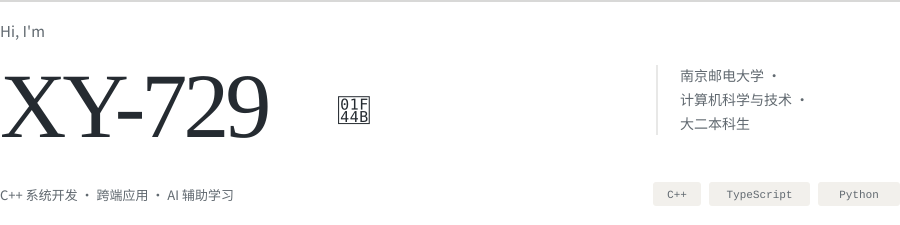

<h1>
  <picture>
    <source media="(prefers-color-scheme: dark) and (max-width: 600px)" srcset="https://raw.githubusercontent.com/XY-729/XY-729/main/assets/editorial/header-dark-mobile.svg">
    <source media="(prefers-color-scheme: light) and (max-width: 600px)" srcset="https://raw.githubusercontent.com/XY-729/XY-729/main/assets/editorial/header-light-mobile.svg">
    <source media="(prefers-color-scheme: dark)" srcset="https://raw.githubusercontent.com/XY-729/XY-729/main/assets/editorial/header-dark.svg">
    <source media="(prefers-color-scheme: light)" srcset="https://raw.githubusercontent.com/XY-729/XY-729/main/assets/editorial/header-light.svg">
    
  </picture>
</h1>

<h2>
  <picture>
    <source media="(prefers-color-scheme: dark)" srcset="https://raw.githubusercontent.com/XY-729/XY-729/main/assets/editorial/section-about-dark.svg">
    <source media="(prefers-color-scheme: light)" srcset="https://raw.githubusercontent.com/XY-729/XY-729/main/assets/editorial/section-about-light.svg">
    
  </picture>
</h2>

你好，我是 **XY-729**。我在通过项目学习 C++、系统机制和应用开发，也尝试把自己学习时遇到的问题做成工具。

- **C++ 实践**：从 JSON 解析器、Qt 桌宠，到 Linux 单机判题器，逐步理解解析、事件处理、进程管理和资源限制。

- **应用开发**：使用 TypeScript 和 Python，尝试把前端交互、后端服务、数据存储与桌面打包串起来。

- **最近在做**：持续迭代 [CodeCourse](https://github.com/XY-729/CodeCourse)，把源码阅读、AI 问答和个性化课程放进同一个学习工作区。

- **关注的细节**：代码是否容易读懂，功能是否经过验证，以及实际使用时是否顺手。

<h2>
  <picture>
    <source media="(prefers-color-scheme: dark)" srcset="https://raw.githubusercontent.com/XY-729/XY-729/main/assets/editorial/section-stack-dark.svg">
    <source media="(prefers-color-scheme: light)" srcset="https://raw.githubusercontent.com/XY-729/XY-729/main/assets/editorial/section-stack-light.svg">
    
  </picture>
</h2>

| 方向 | 项目中使用的技术 |
| --- | --- |
| 编程语言 | **C++17** · **TypeScript** · **Python** |
| Web 前端 | React · Vue 3 · Vite · Monaco Editor |
| 后端服务 | FastAPI · NestJS |
| 桌面与跨端 | Qt Widgets · Electron · Capacitor · 原生微信小程序 |
| 数据与检索 | PostgreSQL · Prisma · SQLite / FTS5 · Tree-sitter |
| 开发与验证 | Git · CMake / CTest · GitHub Actions · Vitest · Linux |

<h2>
  <picture>
    <source media="(prefers-color-scheme: dark)" srcset="https://raw.githubusercontent.com/XY-729/XY-729/main/assets/editorial/section-projects-dark.svg">
    <source media="(prefers-color-scheme: light)" srcset="https://raw.githubusercontent.com/XY-729/XY-729/main/assets/editorial/section-projects-light.svg">
    
  </picture>
</h2>

<h3>
  <a href="https://github.com/XY-729/CodeCourse">
  <picture>
    <source media="(prefers-color-scheme: dark)" srcset="https://raw.githubusercontent.com/XY-729/XY-729/main/assets/editorial/codecourse-dark.svg">
    <source media="(prefers-color-scheme: light)" srcset="https://raw.githubusercontent.com/XY-729/XY-729/main/assets/editorial/codecourse-light.svg">
    
  </picture>
  </a> 
   · 面向源码理解与持续学习的 AI 工作区
</h3>

**项目定位**：面向有编程基础、希望读懂真实开源项目的学习者，解决“从哪里开始读、模块如何协作、遇到陌生概念如何继续学”的问题。把仓库结构、源码阅读、课程生成、上下文问答和学习记录放在同一个工作区，也支持围绕独立技术主题创建学习计划。

**学习流程**：导入仓库或创建学习计划 → 生成学习总纲与课件 → 对照源码阅读和追问 → 将解释、术语与学习记录沉淀到知识网络。

**技术亮点**

- **带源码依据的本地 RAG**：以 SQLite FTS5 建立基础检索，集成基于 Tree-sitter 的结构索引引擎，补充符号定义、调用关系和导入关系。回答引用保留真实文件路径、行号和检索来源，可以直接跳回源码；结构引擎不可用时回退到基础检索。

- **课程与问答共用的知识树**：为概念维护稳定身份，区分通用知识与项目私有符号，将课程完成、术语解释和人工反馈关联到具体知识点与学习范围。课件与后续问答复用所属总纲下的知识子树和已讲范围，让讲解衔接已有学习记录。

- **知识上下文压缩**：使用稳定短 ID、默认字段省略和紧凑节点表示，保留可还原的父子关系与学习状态；模型返回的引用在校验前映射回真实概念 ID，兼顾上下文开销与知识关联的一致性。

- **可恢复的课程生成**：先固定章节规划与职责，再并发生成章节，利用检查点和响应缓存复用已有结果。正文发布与附属知识清单校验分开处理：有效正文可以保留，缺失的知识关联单独标记为待补全，减少格式问题引发的重复生成。

- **交互优先的问答调度**：回答正文增量展示，保存后将术语识别、知识关联等工作交给持久化后台任务；新的后台模型请求会等待前台问答结束，减少后处理对连续追问的影响。

- **围绕阅读设计的前端**：Monaco 源码阅读器与 Markdown 课件支持递归分屏、多标签和阅读位置恢复；通过 Cytoscape.js 展示知识网络，把图布局与物理模拟放进 Web Worker，减少图计算对阅读交互的阻塞。

- **本地优先的跨端交付**：用 Electron 与 PyInstaller 打包 Windows 应用，内置后端、Git 和代码索引依赖；用 Capacitor 适配 Android。索引与学习记录保存在本机，AI 能力连接用户配置的模型 API。

`React` `TypeScript` `Python` `FastAPI` `SQLite / FTS5` `Tree-sitter` `Cytoscape.js` `Electron` `Capacitor`

[下载体验](https://github.com/XY-729/CodeCourse/releases/latest) · [检索实现](https://github.com/XY-729/CodeCourse/blob/main/backend/app/services/index_service.py) · [课程生成](https://github.com/XY-729/CodeCourse/blob/main/backend/app/services/generation_service.py) · [知识网络](https://github.com/XY-729/CodeCourse/tree/main/frontend/src/features/knowledge)

 

<h3>
  <a href="https://github.com/XY-729/CPPJUDGE">
  <picture>
    <source media="(prefers-color-scheme: dark)" srcset="https://raw.githubusercontent.com/XY-729/XY-729/main/assets/editorial/cppjudge-dark.svg">
    <source media="(prefers-color-scheme: light)" srcset="https://raw.githubusercontent.com/XY-729/XY-729/main/assets/editorial/cppjudge-light.svg">
    
  </picture>
  </a> 
   · 面向 OJ 场景的 Linux C++ 判题内核
</h3>

**项目定位**：面向单机 C++ 代码评测，围绕一份提交完成编译、逐测试点运行、资源监控、输出比较和结果记录。重点实践判题系统内部的进程管理、资源隔离与结果判定，通过 CLI 和题目配置组织完整评测流程。

**评测链路**：提交源码 + `problem.json` → 编译 → 受限运行 → 精确或浮点输出比较 → 判定结果与 JSON 日志。

**技术亮点**

- **可配置的评测流程**：题目目录与 `problem.json` 统一描述测试数据、时间、内存、输出大小和编译限制；支持 AC、WA、CE、RE、TLE、MLE、OLE 与 System Error，区分用户程序错误和判题侧故障。

- **进程与资源生命周期管理**：使用子进程、进程组和资源限制控制执行；nsjail 路径通过 barrier pipe 同步父子进程，先将子进程加入 cgroup，再放行执行，并在超限或结束后清理相关进程。

- **基于系统证据的结果分类**：结合退出状态、父进程记录的终止原因与 `memory.events` 中的 `oom_kill` 增量判定结果。例如，普通 `exit(137)` 归为 RE，真实 OOM 才归为 MLE，减少内存超限与异常退出之间的误判。

- **分阶段的沙箱集成**：提供 nsjail 编译与运行路径，运行阶段接入 cgroup v2 内存及进程数限制、受控文件挂载和 seccomp 高风险系统调用拦截；生产模式检查依赖、委派权限和策略配置，条件不足时返回系统错误。

- **可诊断、可回归的工程接口**：提供 `judge`、`doctor` 和版本查询；每次评测保留独立运行目录与带 schema 版本的 JSON 日志。通过 CTest、GitHub Actions 和分层回归用例检查判题结果、配置错误与沙箱行为。

当前以单机 C++ 评测和沙箱机制验证为主；nsjail 的完整安全验证依赖具备 cgroup delegation 的 Linux 环境，验证进展与已知边界见下方记录。

`C++17` `Linux` `CMake / CTest` `nsjail` `cgroup v2` `seccomp` `GitHub Actions`

[使用说明](https://github.com/XY-729/CPPJUDGE#readme) · [Runner 实现](https://github.com/XY-729/CPPJUDGE/blob/master/src/runner.cpp) · [测试用例](https://github.com/XY-729/CPPJUDGE/tree/master/tests) · [沙箱验证记录](https://github.com/XY-729/CPPJUDGE/blob/master/docs/security-test-matrix.md)

 

<h3>
  <a href="https://github.com/XY-729/bookloop-market">
  <picture>
    <source media="(prefers-color-scheme: dark)" srcset="https://raw.githubusercontent.com/XY-729/XY-729/main/assets/editorial/bookloop-dark.svg">
    <source media="(prefers-color-scheme: light)" srcset="https://raw.githubusercontent.com/XY-729/XY-729/main/assets/editorial/bookloop-light.svg">
    
  </picture>
  </a> 
   · 二手教材交易平台
</h3>

包含原生微信小程序、Vue 管理后台和 NestJS API，覆盖教材发布、审核、下单、聊天、交付与退款流程。提供使用模拟支付的网页体验样品。

`TypeScript` `Vue 3` `NestJS` `PostgreSQL` `Prisma` `微信小程序`

[查看源码](https://github.com/XY-729/bookloop-market) · [体验样品](https://xy-729.github.io/bookloop-market/)

 

<h3>
  <a href="https://github.com/XY-729/JSON">
  <picture>
    <source media="(prefers-color-scheme: dark)" srcset="https://raw.githubusercontent.com/XY-729/XY-729/main/assets/editorial/json-dark.svg">
    <source media="(prefers-color-scheme: light)" srcset="https://raw.githubusercontent.com/XY-729/XY-729/main/assets/editorial/json-light.svg">
    
  </picture>
  </a> 
   · C++ JSON 解析器
</h3>

支持嵌套对象与数组解析、文件读取、JSON Pointer 查询、迭代器遍历和基础规则校验，用一个小型库练习数据结构、接口设计与错误处理。

`C++` `JSON Pointer` `Parser`

还做过一个 [Qt 桌宠 deskpet](https://github.com/XY-729/deskpet)：支持点击与闲置动画、GIF 皮肤切换、大小调整和设置持久化。

---

欢迎通过项目的 Issues / Pull Requests 交流 C++、源码阅读与学习工具。
